<picture>
  <source media="(prefers-color-scheme: dark)" srcset="assets/hero-dark.svg">
  
</picture>

  
  
  

<b>6</b> years in Java &amp; Python systems &nbsp;·&nbsp; <b>40+</b> branches served at Brandt &nbsp;·&nbsp; <b>4</b>-person team led &nbsp;·&nbsp; <b>IBM</b> AI Developer certificate, 2026

---

### `01` About

Backend developer with six years in Java and Python enterprise systems. At **Tata Consultancy Services** and **Newgen Software** I delivered Liferay DXP features for Lenovo's multisite Partner Hub and loan and credit-card process flows for ICICI Bank. At **Brandt Tractor** I build Python data pipelines, Power Apps and Power Automate workflows, and the analytics behind labour pricing across 40+ branches.

Through Saskatchewan Polytechnic's **Artificial Intelligence & Data Analytics** program and the **IBM AI Developer Professional Certificate**, I've focused on connecting large language models to real products. Open to **Senior Backend / AI Developer** roles.

**Stack**

`Python` `FastAPI` `Java 8` `Rust (learning)` `Kotlin` `SQL` `REST APIs` `Liferay DXP` `JUnit`
`LLM integration` `RAG` `NLP` `IBM Watson` `NVIDIA NIM` `ChromaDB` `XGBoost` `Claude Code` `GitHub Copilot`
`Power BI` `Power Apps` `Power Automate` `Git` `GitLab` `Jenkins` `MySQL` `Oracle` `AWS`

---

### `02` AI & LLM experience

| | |
|---|---|
| **LLM-powered product features** | Python/FastAPI backends that connect LLMs to AI diagnostics, smart recommendations and natural-language interfaces |
| **RAG and PDF chatbots** | Retrieval pipelines that ground answers in source documents, including hybrid RAG + ML estimators |
| **NLP, vision and speech** | NLP, object detection and IBM Watson speech-to-text from the AI & Data Analytics program (2023) |
| **AI at work** | Data analysis, machine learning and AI applied to day-to-day operational problems at Brandt |
| **AI-assisted development** | Writing and debugging Python with Claude Code and GitHub Copilot |

---

### `03` Selected projects

Oldest first

| Project | What it is |
|---|---|
| 🎓 **AI Capstone Projects** | Python/FastAPI backends connecting LLMs to AI diagnostics, smart recommendations, natural-language interfaces, RAG and PDF chatbots. |
| 🔎 [**SaskJobs Scraping API**](https://github.com/rahul-bavaliya/saskjobs) | Python REST API that scrapes SaskJobs listings into clean, structured data. |
| 🧠 [**Construction Cost Estimator**](https://github.com/rahul-bavaliya/SaskEnergy) | Hybrid RAG assistant for early-stage construction estimates, with a governance layer that keeps answers source-cited. |
| 🦀 [**Quoto**](https://github.com/rahul-bavaliya/quoto) | Quoting and repair-order system for service shops, written in Rust. Integer-cents money, SK/AB GST/PST, quote lifecycle enforced by the type system. |
| 🤖 **Self-Learning Browser Agent** | *In progress.* An agent on pretrained models that operates Chrome and Edge and improves from its own runs. |

More on the [portfolio site](https://rahul-bavaliya.github.io/#work).

---

### `04` Experience

| When | Role |
|---|---|
| **Jan 2024 – Present** | **Service Pricing Manager**, Brandt Tractor Ltd, Regina, SK |
| Jun 2021 – Dec 2021 | Senior Software Engineer, Newgen Software Technologies (Remote, India) |
| Feb 2019 – May 2021 | Software Engineer, Tata Consultancy Services, Gandhinagar, India |
| Mar 2018 – Dec 2018 | Android Developer, Jnext Development, Bhavnagar, India |

**Education:** Saskatchewan Polytechnic, AI & Data Analytics (2023) and Technology Management (2022) · B.E. Information Technology, Gujarat Technological University (2018)

---

### `05` Contact

Regina, Saskatchewan · [Rahul.Bavaliya.Jobs@gmail.com](mailto:Rahul.Bavaliya.Jobs@gmail.com) · [LinkedIn](https://www.linkedin.com/in/rahul-bavaliya) · [rahul-bavaliya.github.io](https://rahul-bavaliya.github.io)
